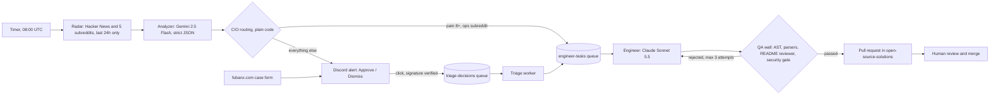

# FUBANX

**An event-driven SRE agent that finds unsolved operations problems, puts a human in front of every risky decision, and ships QA-checked fixes as pull requests.**

> ### See it live at [fubanx.com](https://fubanx.com)
> ### Check out the solutions FUBANX has built: [AdrianStudio/open-source-solutions](https://github.com/AdrianStudio/open-source-solutions)
> Every fix lands there as a reviewed pull request, organized as `<stack>/<category>/<project>/` with the code and a README for each one.

## Why it exists

Sysadmins, MSPs and DevOps engineers describe the same operational pain every day on Hacker News and Reddit: a backup that fails silently, a print spooler that needs a restart, a vendor flooding them with CVEs. Most of those threads end without a working script.

FUBANX reads those communities every morning, keeps only the problems that are real, painful and still unsolved, and turns the best ones into small, reviewable automation: a Python script, a PowerShell script or an OpenTofu module. Anyone can also submit a case directly at [fubanx.com](https://fubanx.com).

Generating code with an LLM is easy. Generating code a senior engineer would merge, without letting strangers steer the model or the bill, is the real problem FUBANX solves.

## How it works



FUBANX runs on Azure Functions (Python 3.12, Consumption plan), with Storage Queues between every stage and Table Storage as its memory. The infrastructure is provisioned with OpenTofu, and [fubanx.com](https://fubanx.com) runs on Next.js on Vercel.

| Stage | What happens |
| --- | --- |
| Radar | Every morning at 08:00 UTC it collects posts and their top comments from Hacker News and r/devops, r/sysadmin, r/selfhosted, r/msp and r/SaaS. Anything older than 24 hours is dropped before a model sees it. |
| Analyzer | A cheap model scores each post (problem, niche, pain from 1 to 10, why current tools fail) as strict JSON validated in code. Threads already solved in the comments are discarded. |
| Routing | Plain code, not a model. Only cases with pain 8 or higher from r/sysadmin, r/msp, r/devops or r/selfhosted go to engineering on their own. Everything else waits for a human. |
| Triage | Every opportunity becomes a Discord card with Approve and Dismiss buttons. Web submissions always need approval. |
| Engineer | A stronger model writes one artifact in its assigned stack, with its README, and iterates against the QA wall. |
| Pull request | One branch, one commit (code plus README), one pull request. Retries never open a second one. Nothing is merged without a human. |
| Reporting | The outcome of every task, with its cost, goes back to Discord, and a daily report at 19:00 UTC sums up PRs, failures, tokens and spend. |

## Human triage: the barrier against prompt injection

Anyone on the internet can type into a form, and anyone can write a Reddit post designed to steer an AI agent. FUBANX puts a person between that text and the engineering model.

- **Web submissions never reach a model.** When a case submitted on fubanx.com is approved, Discord opens a form where the operator rewrites it in their own words: title, role and brief. Only that rewritten brief goes to the engineer. The visitor's original text is only ever shown to a human.
- **Spend is gated.** Outside a narrow, deterministic routing rule, nothing costs a single engineering token until a person clicks Approve.
- **Clicks are verified.** Every Discord interaction is checked against the application's Ed25519 signature within a 5 minute window, and only allowlisted Discord accounts can approve. If the allowlist is empty, nobody can.
- **The web tier holds almost nothing.** The website can only add messages to one Azure queue through a scoped token. It never holds storage keys, model keys or GitHub credentials.
- **Model output stays untrusted.** The engineer has no shell and no tools. It can only produce text that must pass deterministic checks, and its result is a pull request that a human reviews.

## The QA wall

Every artifact is written by a language model and reviewed by code. No model takes part in the review. Each rejection goes back to the model as feedback, with at most 3 attempts per case, and nothing becomes a pull request until every reviewer passes.

| Reviewer | What it rejects |
| --- | --- |
| Python AST review | `dict.get` and `getattr` fallbacks, `except Exception`, bare or empty handlers, catching `KeyError` to skip data, nested functions, single letter names |
| PowerShell review | Parser errors, untyped `catch {}`, `-ErrorAction SilentlyContinue`, scripts that cannot run directly with their parameters |
| OpenTofu review | `tofu fmt`, `tofu init` and `tofu validate` in a sandbox |
| Comment review | Narrated or numbered steps, decorative headers, first person, emojis, and words that admit fake logic such as "placeholder", "simulated" or "for demonstration" |
| README reviewer | Missing Problem, Prerequisites or Usage sections, undocumented environment variables, usage that does not show the real file name or the apply flag, filler wording, more than 350 words |
| Repository layout | Anything outside `<stack>/<category>/<project>/`, unknown categories, vague project names |
| Security gate | Hardcoded secrets or tenant IDs, arbitrary code execution, destructive deletes, disabled TLS validation or security controls |

Three rules apply to everything FUBANX ships:

- **Dry run by default.** Any state change (isolating a device, restarting a service, purging a queue) needs an explicit `--apply` or `-Apply`.
- **Fail loudly.** A missing required value raises immediately. Optional values are tested explicitly instead of hidden behind defaults.
- **No simulated code.** If a case cannot be solved against real APIs, the model declines it instead of faking it.

Real rejections from production runs:

```text
line 43: silent fallback `os.environ.get("AWS_SESSION_TOKEN")`
line 125: catching `KeyError` turns direct indexing back into a silent fallback
line 37: "for demonstration" signals simulated or placeholder logic
line 82: silent fallback `report["data"].get("cve_id", "N/A")`
line 83: untyped `catch { }`; catch a specific exception type or let it raise
README: `## Usage` must show `iam_persistence_hunter.py`
```

The full history of interventions is on the QA Wall at [fubanx.com](https://fubanx.com).

## Models and real costs

FUBANX uses a cheap model where volume is high and a strong model where quality decides whether a pull request is mergeable. Every call records its real cost as reported by the API.

| Stage | Model | Measured cost |
| --- | --- | --- |
| Radar, analysis, content | Gemini 2.5 Flash | Under $0.05 for a full daily run (about 56k tokens) |
| Engineering | Claude Sonnet 5.5 | About $0.08 per pull request |

Why the split: on 2026-11-18 the engineer was still running on Gemini 2.5 Flash, and both cases routed that day failed the QA wall on all 3 attempts. On Claude Sonnet 5.5, four real cases passed on the first attempt at $0.073 to $0.093 each. Re-running those two failed cases in production opened [#8](https://github.com/AdrianStudio/open-source-solutions/pull/8) and [#9](https://github.com/AdrianStudio/open-source-solutions/pull/9) at $0.074 each.

Spend is capped by design:

- **Attempts:** at most 3 per case.
- **Time:** no new attempt starts after 5 minutes.
- **Money:** a hard cost ceiling for each attempt run.
- **Concurrency:** a single worker instance.

## Built with

Azure Functions · Azure Storage Queues and Tables · OpenTofu · Python 3.12 · Pydantic · OpenRouter · Discord interactions · Next.js on Vercel · GitHub API

## Author

**Adrián Tamargo**, Cloud & DevOps Engineer, Barcelona
[fubanx.com](https://fubanx.com) · [GitHub](https://github.com/AdrianStudio) · [LinkedIn](https://linkedin.com/in/adrian-tamargo/)

The engine source is private. This repository documents how FUBANX works; the code it produces is public in [open-source-solutions](https://github.com/AdrianStudio/open-source-solutions).
